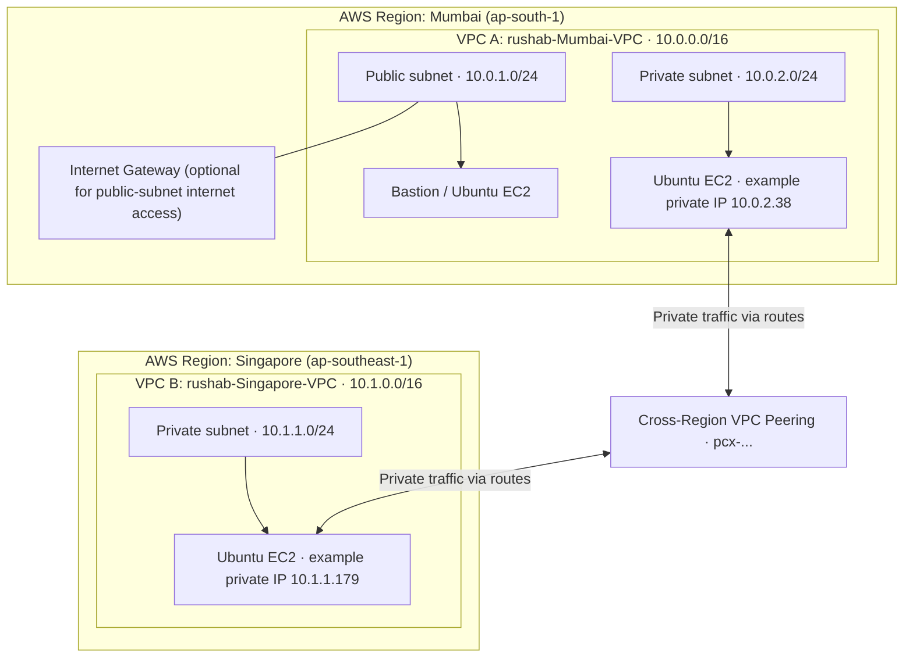

# AWS Cross-Region VPC Peering: Mumbai and Singapore

A beginner-friendly AWS networking lab that connects two Amazon VPCs in different AWS Regions using **VPC Peering**. The goal is to enable private-IP communication between EC2 instances in the two VPCs without routing that traffic over the public internet.

> **Region note:** AWS does not have a Region named Hyderabad. This lab uses **Mumbai (`ap-south-1`)** as the first side and **Singapore (`ap-southeast-1`)** as the second side.

## Architecture diagram



The IP addresses above are examples from the lab discussion. Replace them with the current values shown in your AWS Console.

## Project objective

- Create two VPCs in separate AWS Regions.
- Create subnets in each VPC.
- Create and accept a cross-Region VPC peering connection.
- Add routes on both sides.
- Configure security groups to permit only the required traffic.
- Test communication between EC2 instances using private IP addresses.

## Address plan

| Resource | AWS Region | Example CIDR / IP |
|---|---|---|
| Mumbai VPC | Mumbai `ap-south-1` | `10.0.0.0/16` |
| Mumbai public subnet | Mumbai | `10.0.1.0/24` |
| Mumbai private subnet | Mumbai | `10.0.2.0/24` |
| Mumbai private EC2 | Mumbai | `10.0.2.38` |
| Singapore VPC | Singapore `ap-southeast-1` | `10.1.0.0/16` |
| Singapore private subnet | Singapore | `10.1.1.0/24` |
| Singapore private EC2 | Singapore | `10.1.1.179` |

**Important:** VPC CIDR ranges must not overlap. Confirm actual instance IP addresses in the console before testing.

## Prerequisites

- An AWS account with permission to create VPCs, subnets, route tables, Internet Gateways, peering connections, security groups, and EC2 instances.
- An SSH key pair for each EC2 instance as required by your setup.
- Ubuntu EC2 instances for SSH-based testing (optional if you are only building the network).
- A Mac/Linux terminal for SSH commands.

## Step-by-step implementation

### 1. Create the Mumbai VPC

1. Open the [AWS VPC Console](https://console.aws.amazon.com/vpc/) and select **Asia Pacific (Mumbai) — `ap-south-1`**.
2. Go to **Your VPCs → Create VPC → VPC only**.
3. Name the VPC `rushab-Mumbai-VPC`.
4. Set IPv4 CIDR to `10.0.0.0/16`.
5. Create the VPC.
6. Create two subnets in this VPC:
   - `Mumbai-Public`: `10.0.1.0/24`
   - `Mumbai-Private`: `10.0.2.0/24`

### 2. Configure the Mumbai Internet Gateway (optional)

An Internet Gateway is **not required for VPC peering**. It is only required if an instance in the public subnet needs direct internet connectivity using a public IPv4 address.

1. In Mumbai, go to **VPC → Internet gateways → Create internet gateway**.
2. Name it `Mumbai-IGW`.
3. Attach it to `rushab-Mumbai-VPC`.
4. Open **Route tables** and select the route table associated with the public subnet.
5. Add route `0.0.0.0/0` with target the attached Internet Gateway (`igw-...`).
6. Ensure the public EC2 instance has a public IPv4 address and the security group permits SSH (TCP 22) from your own public IP only.

Do not add the Internet Gateway as the target for VPC-to-VPC traffic.

### 3. Create the Singapore VPC

1. Switch the AWS Region to **Asia Pacific (Singapore) — `ap-southeast-1`**.
2. Go to **Your VPCs → Create VPC → VPC only**.
3. Name the VPC `rushab-Singapore-VPC`.
4. Set IPv4 CIDR to `10.1.0.0/16`.
5. Create a subnet named `Singapore-Private` with CIDR `10.1.1.0/24`.

### 4. Create the VPC peering connection

1. Switch back to Mumbai (`ap-south-1`).
2. Go to **VPC → Peering connections → Create peering connection**.
3. Name it `Mumbai-Singapore-Peering`.
4. Select `rushab-Mumbai-VPC` as the requester VPC.
5. Choose **My account** and **Another Region**, then select Singapore (`ap-southeast-1`) as the accepter Region.
6. Select or enter the **actual Singapore VPC ID**, which starts with `vpc-`.

> Do not enter the VPC name (such as `rushab-Singapore-VPC`) into a field that expects a VPC ID. This causes the error `Invalid id ... (expecting "vpc-...")`.

7. Create the request.
8. Switch to Singapore, open **VPC → Peering connections**, select the pending request, and choose **Actions → Accept request**.
9. Verify the peering connection status is **Active**.

### 5. Add routes on both sides

Peering does not automatically add routes. Add routes to the route tables associated with subnets that need to communicate.

| Route table | Destination | Target |
|---|---|---|
| Mumbai subnet route table(s) | `10.1.0.0/16` | VPC peering connection `pcx-...` |
| Singapore subnet route table(s) | `10.0.0.0/16` | Same peering connection `pcx-...` |

Steps:

1. In Mumbai, open **VPC → Route tables**.
2. Select the route table used by the Mumbai subnet that needs access to Singapore.
3. Choose **Routes → Edit routes → Add route**.
4. Set destination to `10.1.0.0/16` and target to the VPC peering connection (`pcx-...`), then save.
5. Switch to Singapore.
6. Select the route table used by `Singapore-Private`.
7. Add destination `10.0.0.0/16` with target the same `pcx-...` connection, then save.
8. If subnets use separate route tables, add the relevant route to every route table that needs connectivity.

### 6. Configure security groups

Security groups must permit the required traffic. For example:

- For SSH to a private EC2 instance, allow inbound TCP `22` from the specific source instance or an appropriate source CIDR.
- For a ping test, allow inbound ICMP IPv4 from the other VPC's CIDR.
- Keep SSH limited to trusted sources. Do not open SSH to `0.0.0.0/0`.
- Network ACLs must also permit the required traffic and return traffic.
- For cross-Region peering, use CIDR-based rules; cross-Region security-group references are not supported.

### 7. Connect to the Mumbai EC2 instance

From your Mac terminal, use the actual public IP and the matching private key:

```bash
chmod 400 mac-rushab-key-mumbai-3-step-2026.pem
ssh -i mac-rushab-key-mumbai-3-step-2026.pem ubuntu@<MUMBAI_PUBLIC_IP>
```

Replace `<MUMBAI_PUBLIC_IP>` with the current public IPv4 address shown in the EC2 console.

If SSH times out, check:
- EC2 is running and status checks pass.
- Public IP is correct.
- Security group allows TCP 22 from your current public IP.
- The subnet route table has `0.0.0.0/0 → igw-...`.
- The Internet Gateway is attached to the correct VPC.
- Network ACL rules allow SSH and return traffic.

### 8. Connect from one EC2 instance to the other

The lab used an example first host `10.0.2.38` and second host `10.1.1.179`.

From the first EC2 instance, the command is:

```bash
ssh -i private2.pem ubuntu@10.1.1.179
```

Notes:
- The username for a standard Ubuntu AMI is usually `ubuntu` (not `ununtu`).
- `private2.pem` must exist on the machine running the SSH command and must match the key pair used by the destination EC2 instance.
- The error `Permission denied (publickey)` usually indicates an incorrect username, missing/wrong key, or a key pair mismatch. It is not by itself proof of a VPC peering problem.
- Avoid copying private keys to servers for production workloads. Prefer AWS Systems Manager Session Manager or carefully configured SSH agent forwarding where suitable.
- Do not add an extra `q` at the end of the SSH command; the shell may try to execute it as a remote command.

### 9. Test private connectivity

From a host in Mumbai, test the Singapore instance's actual private IP:

```bash
ping 10.1.1.179
```

Replace the example IP with the current private IP. Ping may fail if ICMP is not permitted, even when the peering connection is correctly configured. Test the actual application port as well, if applicable.

## Troubleshooting

| Error / symptom | Checks |
|---|---|
| `Invalid id ... (expecting "vpc-...")` | Use the accepter VPC's actual ID beginning with `vpc-`, not its name. |
| SSH `Operation timed out` | Check public IP, security group TCP 22, Internet Gateway route, subnet, and network ACLs. |
| SSH `Permission denied (publickey)` | Check username, key file, file permissions (`chmod 400`), and destination key pair. |
| `q: command not found` | Remove the extra `q` at the end of the SSH command. |
| Private-IP traffic fails | Check peering status, both route tables, non-overlapping CIDRs, security groups, network ACLs, and the destination service. |
| Ping fails | Confirm ICMP is allowed; use another relevant connectivity test if appropriate. |

## Validation checklist

- [ ] Both VPCs exist in the intended Regions.
- [ ] VPC CIDRs do not overlap.
- [ ] Required subnets exist.
- [ ] Peering connection status is **Active**.
- [ ] Mumbai route table has `10.1.0.0/16 → pcx-...`.
- [ ] Singapore route table has `10.0.0.0/16 → pcx-...`.
- [ ] Security groups and network ACLs allow the intended traffic.
- [ ] Private-IP connectivity has been tested.

## Cleanup

To avoid ongoing costs:

1. Terminate EC2 instances you no longer need.
2. Release unused Elastic IP addresses.
3. Delete unused NAT Gateways if you created any (these can incur charges).
4. Delete the VPC peering connection when finished.
5. Remove dependent resources and delete VPCs only if they are no longer needed.

An Internet Gateway itself does not have an hourly charge, but EC2, NAT Gateways, Elastic IPs in some states, and data transfer can incur charges.

## Useful links

- [AWS VPC Console](https://console.aws.amazon.com/vpc/)
- [EC2 Instances in Mumbai](https://ap-south-1.console.aws.amazon.com/ec2/home?region=ap-south-1#Instances:)
- [AWS documentation: Create a VPC peering connection](https://docs.aws.amazon.com/vpc/latest/peering/create-vpc-peering-connection.html)

---

**Portfolio note:** Update the example IP addresses, VPC IDs, screenshots, and test results to match your own environment before publishing. Never upload `.pem` private keys, AWS access keys, passwords, or other secrets to GitHub.
